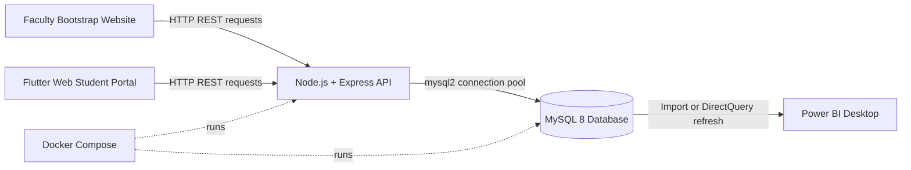
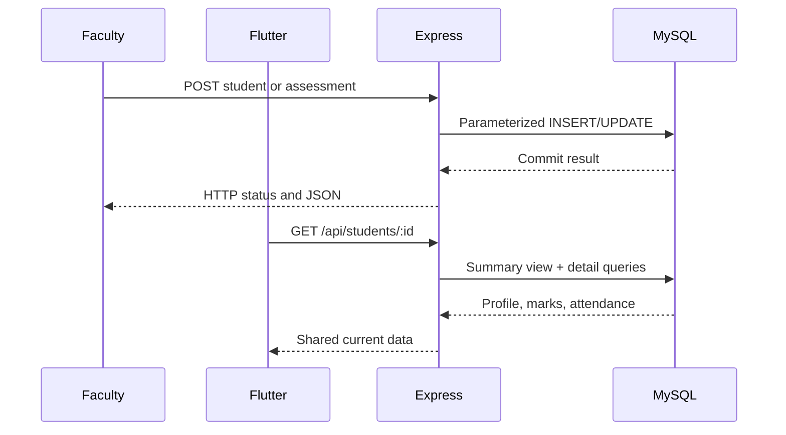
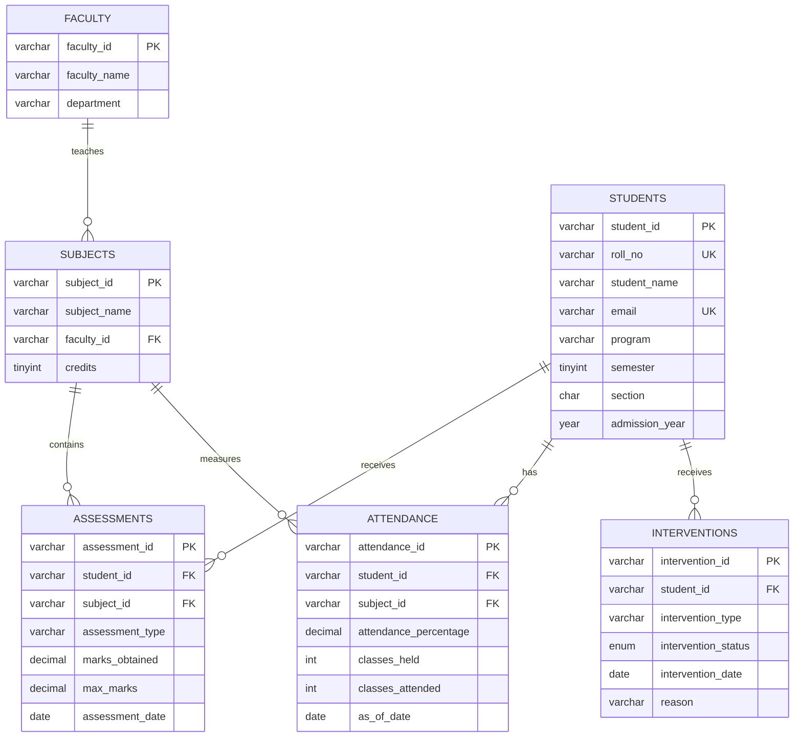
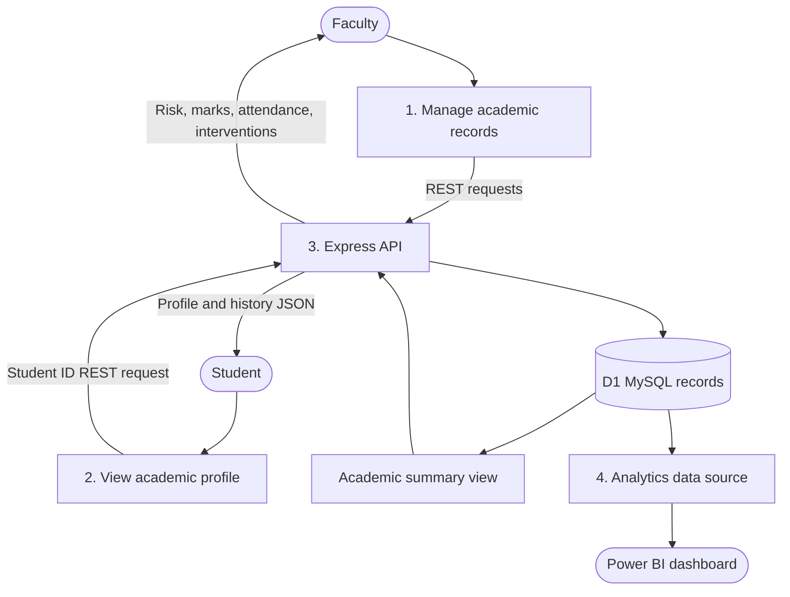

# UniTrack Architecture and Diagrams

## Problem statement

Academic records are often spread across marksheets, attendance files and faculty notes. UniTrack gives faculty one place to maintain these records and gives students a consistent view of their own academic profile.

## Objectives and scope

- Store students, faculty, subjects, assessments, attendance and interventions in MySQL.
- Expose the records through a simple Express REST API.
- Provide a Bootstrap faculty dashboard for academic operations.
- Provide a Flutter Web student portal using the same API.
- Apply transparent rule-based academic risk classification.
- Prepare a reproducible Docker and Power BI integration path.

The prototype uses synthetic data and simplified demo access. It does not implement production authentication, institutional authorization or machine-learning prediction.

## System architecture

## Request workflow

## ER diagram

## Data-flow diagram (DFD Level 1)

## Risk rules

The database view calculates risk after separate per-student aggregations, preventing accidental multiplication from joining multiple one-to-many tables:

- High: average marks below 40% OR average attendance below 65%.
- Medium: average marks below 55% OR average attendance below 75%.
- Low: neither threshold is crossed.
